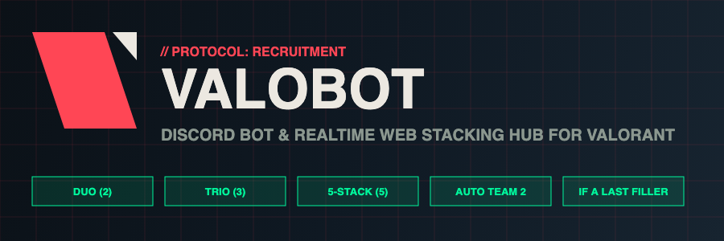

<h1 align="center">
  <a href="https://github.com/Nytuo/Valobot">
    
  </a>
</h1>
<div align="center">
<h2>Valobot</h2>
Find and stack mates for Valorant the easy way — Discord Bot & Real-Time Web Hub
  <br />
  <br />
  <a href="https://github.com/Nytuo/Valobot/issues/new?assignees=&labels=bug&template=01_BUG_REPORT.md&title=bug%3A+">Report a Bug</a>
  ·
  <a href="https://github.com/Nytuo/Valobot/issues/new?assignees=&labels=enhancement&template=02_FEATURE_REQUEST.md&title=feat%3A+">Request a Feature</a>
  ·
  <a href="https://github.com/Nytuo/Valobot/discussions">Ask a Question</a>

</div>

<div align="center">
<br />

[](LICENSE)
[](https://github.com/Nytuo)
[](docker-compose.yml)
[](https://discord.js.org/)

</div>

<details open="open">
<summary>Table of Contents</summary>

- [About](#about)
- [What Valobot Can Do](#what-valobot-can-do)
- [6-Way Voting System](#6-way-voting-system)
- [Smart Stacking & Roster Algorithm](#smart-stacking--roster-algorithm)
- [Party Lifecycle](#party-lifecycle)
- [Rank & Stats Recap (optional)](#rank--stats-recap-optional)
- [Diagonal CANCELLED Rubber Stamp](#diagonal-cancelled-rubber-stamp)
- [Web Dashboard (valobot.example.com)](#web-dashboard-valobotnytuofr)
- [Security & Anti-Spam Protections](#security--anti-spam-protections)
- [Docker Compose Deployment](#docker-compose-deployment)
- [Apache Reverse Proxy (valobot.example.com)](#apache-reverse-proxy-valobotnytuofr)
- [Discord Developer Portal Setup](#discord-developer-portal-setup)
- [Environment Variables](#environment-variables)
- [Technologies](#technologies)
- [Authors & contributors](#authors--contributors)
- [License](#license)

</details>

---

## About

**Valobot** is a self-hosted Discord bot and real-time Web Application engineered to organize and fill Valorant party stacks (Duo, Trio, or Full 5-Stack).

Instead of sending messy group messages, players launch a recruitment session via Discord slash commands or directly through the web dashboard. Teammates vote on their availability with a single click, and the bot automatically sorts players into Team 1, forms a secondary Team 2 if counts permit, routes extra players to reserves, and seals cancelled sessions with an authentic diagonal rubber stamp.

---

## What Valobot Can Do

- **Flexible Party Sizes:**
  - `5-Stack` (Full team)
  - `Trio` (3-stack)
  - `Duo` (2-stack)

- **Slash Commands with Aliases:**
  - Launch votes directly using `/valo`, `/valorant`, or `/youwanttoplay`
  - Pass custom parameters (`party_time`, `vote_deadline`, `party_size`, `target_role`, `note`)
  - Sender Modal UI: typing `/valo` with no arguments opens an interactive Discord modal form

- **Discord Relative Countdown Timers:**
  - Native Discord timestamps (`<t:TIMESTAMP:F>`, `<t:TIMESTAMP:R>`) adapt to every user's local timezone
  - Auto-locking: when the vote deadline is reached, voting closes and the final roster is announced

- **Automatic Host Auto-Vote:**
  - The session creator is automatically voted as *"I'm sure to be there"* upon launch, with the ability to modify or withdraw their vote later

- **Real-Time Web Dashboard (`valobot.example.com`):**
  - Dark Valorant HUD theme (Radianite red `#ff4655`, dark slate `#0f1923`, neon mint `#00f59b`)
  - Live bi-directional synchronization powered by WebSockets
  - Live visual slot indicators (#1 to #5) showing locked players and open spots
  - Interactive web voting directly from your browser

- **Channel Lockdown & Admin Containment:**
  - Contain Valobot commands to a designated channel via `ALLOWED_CHANNEL_IDS` or Discord's native Integration settings
  - Prevents bot commands from cluttering general channels

---

## 6-Way Voting System

Members cast their availability by clicking interactive buttons under the Discord message or on the Web App:

| Vote Option | Button | Description & Priority Logic |
|---|---|---|
| **Je suis chaud** (sure) | 🔥 green | First-come, first-served slot in the active stack (Team 1). Overflow creates Team 2. |
| **Je tente** (maybe) | 🤞 grey | Tentative players, listed but never counted in the roster. |
| **Si dernier recours** (if a last) | 🦸 blurple | Fills open slots after the "sure" players, in order of response. |
| **Remplaçant** (backup) | 🎒 grey | Fills the remaining open slots after the "if a last" players, in order of response. |
| **Nan, flemme** (no) | 🏃 red | Clearly marks unavailable teammates. |
| **Didn't respond** | 👻 | Every human who can see the channel (or has the target role) and has not voted yet. |
| **Effacer mon vote** | 🗑️ | Change or remove your vote. |

Button emojis are chosen to stay readable on their button colour (Discord only offers four button colours).

---

## Smart Stacking & Roster Algorithm

1. **Team 1:** takes the first N *sure* players in order of response timestamp.
2. **Team 2 & more:** when *sure* players reach 2N, a second squad is created, and so on.
3. **Filling open slots:** if the last squad is not full, open slots are filled by *if a last* players first, then *backup* players (only when at least one *sure* player is in that squad).
4. **Reserves:** *if a last* and *backup* players that were not needed stay on the bench.

---

## Party Lifecycle

1. **Created** (slash command, modal or web). Minimum lead time is 3 minutes, so `now` means "in 3 minutes".
2. **Joining:** each time somebody joins (sure / maybe / if a last / backup), the bot posts the session message again so it is always the **last message of the channel**, and deletes the old one.
3. **Reminder:** at the configured time, unresponsive members are pinged.
4. **Vote deadline:** the session is marked *deadline passed*, but **votes are still accepted until the real match time**.
5. **Match time:**
   - not enough players for a full squad → the session is **cancelled automatically** (stamp + flop message);
   - otherwise vote buttons close, a rank snapshot is posted (if stats are enabled) and a **📊 Résultats** button appears.
6. **One invite, several games:** play as many games as you like; the recap adds them all up.

---

## Diagonal CANCELLED Rubber Stamp

If the host or a server administrator clicks **"🛑 Cancel Vote"**:

- The message **remains in the Discord feed** without being deleted.
- All voting buttons are locked and disabled.
- The server-side Canvas rendering engine (`@napi-rs/canvas`) generates a high-resolution PNG banner overlaid with an authentic, tilted rubber stamp reading **`CANCELLED`** in bold crimson ink with distress textures.
- The web app mirrors the same diagonal stamp animation in real time.

---

## Web Dashboard (`valobot.example.com`)

Valobot includes a companion web dashboard running on Node.js and WebSockets behind your Apache reverse proxy:

- **Live Stacking Overview:** Real-time roster view, countdown timers, and team status.
- **Web Session Launcher:** Launch recruitment votes to specific Discord channels with custom time chips (`+30m`, `+1h`, `21:00`, `15m before`).
- **Interactive Web Voting:** Players can vote directly from their web browser.
- **Demo Mode:** Includes a *"✨ Load Demo Session"* button to test and preview stacking rosters without needing an active bot connection.

---

## Rank & Stats Recap (optional)

Valobot can show each player's **rank, RR, K/D/A, ACS, ADR and HS%** before and after the games.

**Data source:** [tracker.gg](https://tracker.gg/valorant/) has no self-serve Valorant API (and scraping it is against its terms), and Riot's official API needs a production key. Valobot therefore uses the unofficial **[HenrikDev API](https://docs.henrikdev.xyz)** (free key) and links each player to their tracker.gg profile. Swap `src/services/valorantStats.js` to change provider.

**Linking (opt-in, nothing is guessed):**
- `/valolink riot_id:Pseudo#TAG [region]` links your Riot ID (checked against the API). `/valounlink` deletes it.
- `/valolink` with **no argument** gives you a one-click button: Discord asks you to authorize Valobot (scopes `identify` + `connections`), the bot reads the **Riot Games connection** of your Discord profile and links it. No dashboard login or session is created. (A bot can never read connections on its own: Discord only exposes them to an app the user authorized.)
- Only linked players appear in recaps. Data stored: Discord ID, Riot ID, region (`data/profiles.json`).

**Flow:**
1. At match time the bot posts a **before** snapshot (ranks).
2. When you're done, press **📊 Résultats** under the session message (or `/valoresult`). Host and players only, 45 s cooldown.
3. The bot lists the games you played together (solo games are ignored), per-player stats, rank change in RR, MVP and "boulet" of the night. Press it again after more games.

Enable with `HENRIK_API_KEY` (see [Environment Variables](#environment-variables)). Without it, the feature is simply off.

> Valobot isn't endorsed by Riot Games and doesn't reflect the views or opinions of Riot Games or anyone officially involved in producing or managing Riot Games properties.

---

## Security & Anti-Spam Protections

- **Login required:** session lists, banners and the live WebSocket are only served to logged-in Discord users, and only for servers (and channels) they can access.
- **Signed cookies:** HttpOnly, SameSite=Lax, `Secure` over HTTPS, signed with `SESSION_SECRET`; OAuth login uses an anti-CSRF `state`.
- **Web hardening:** CSP and security headers, same-origin check on every write, rate limits, 10 KB body limit, WebSocket origin check.
- **Ping permissions:** `@everyone` / role pings only happen if the member who launched the session could send them themselves.
- **Mentions never leak:** edits and reposts never ping; reminders only ping the intended users.
- **Sanitization:** notes and display names lose mentions, links, masked links and hidden characters (50 chars max).
- **Limits:** one active session per channel on the web, max 3 active per host, 3-minute web cooldown, matches within 14 days.
- **Container:** runs as non-root, all Linux capabilities dropped, port bound to `127.0.0.1`.
- **Data at rest:** atomic writes, owner-only file permissions. `data/` is git-ignored.

---

## Docker Compose Deployment

Valobot is designed to be executed under **Docker Compose**:

### 1. Configuration (`.env`)

Copy `.env.example` to `.env` and fill in your values (see [Environment Variables](#environment-variables)). Generate the session secret with:

```bash
openssl rand -hex 32
```

> 💡 **Port:** `PORT=6788` in `.env` is passed to the container and published on `127.0.0.1:6788` only. Your reverse proxy is the public entry point.
>
> 💡 **Permissions:** the entrypoint fixes the ownership of `./data` on start, then runs the app as the unprivileged `node` user (uid 1000). If you see `EACCES ... sessions.json`, rebuild with `docker compose up -d --build`.
>
> 🖼️ **Memes:** reminder / flop images must be direct image files. Drop `.gif/.png/.jpg/.webp` files (max 8 MB) in `assets/memes/flop/` and `assets/memes/reminder/`, or set `FLOP_MEME_URLS` / `REMINDER_MEME_URLS` to direct image links. Page links (like `klipy.com/gifs/...`) cannot be displayed in an embed, so they are posted as a plain link that Discord unfurls.

### 2. Start the Service

```bash
# Build image and start container in background
docker compose up -d --build

# View real-time logs
docker compose logs -f

# Stop the container
docker compose down
```

---

## Apache Reverse Proxy (`valobot.example.com`)

The project includes a ready-to-use VirtualHost configuration in [`apache/valobot.conf`](apache/valobot.conf):

```apache
<VirtualHost *:80>
    ServerName valobot.example.com
    RewriteEngine On
    RewriteCond %{SERVER_NAME} =valobot.example.com
    RewriteRule ^ https://%{SERVER_NAME}%{REQUEST_URI} [END,NE,R=permanent]
</VirtualHost>

<VirtualHost *:443>
    ServerName valobot.example.com

    SSLEngine on
    SSLCertificateFile /etc/letsencrypt/live/example.com/fullchain.pem
    SSLCertificateKeyFile /etc/letsencrypt/live/example.com/privkey.pem
    IncludeOptional /etc/letsencrypt/options-ssl-apache.conf

    ProxyPreserveHost On
    ProxyRequests Off

    RequestHeader set X-Forwarded-Proto "https"
    RequestHeader set X-Forwarded-Port "443"

    # WebSocket Proxy
    RewriteEngine On
    RewriteCond %{HTTP:Upgrade} =websocket [NC]
    RewriteRule /(.*)           ws://127.0.0.1:6788/$1 [P,L]

    ProxyPass /ws ws://127.0.0.1:6788/ws
    ProxyPassReverse /ws ws://127.0.0.1:6788/ws

    # Main Web App & API
    ProxyPass / http://127.0.0.1:6788/
    ProxyPassReverse / http://127.0.0.1:6788/

    Header always set X-Content-Type-Options "nosniff"
    Header always set X-Frame-Options "DENY"
    Header always set Referrer-Policy "no-referrer"
    Header always set Strict-Transport-Security "max-age=31536000; includeSubDomains"

    ErrorLog logs/valobot_error.log
    CustomLog logs/valobot_access.log combined
</VirtualHost>
```

> ⚠️ If Apache runs inside Docker on an external network (e.g. `proxy-nw`), replace `127.0.0.1:6788` with `valobot:6788`.

---

## Discord Developer Portal Setup

Everything is configured at <https://discord.com/developers/applications> → your application.

### Recap

| Where | Setting | Value |
|---|---|---|
| **General Information** | Application ID | → `DISCORD_CLIENT_ID` |
| **Bot** | Token (Reset Token) | → `DISCORD_BOT_TOKEN` (secret, never commit it) |
| **Bot** | Public Bot | **Off** (recommended: only you can invite it) |
| **Bot** | Requires OAuth2 Code Grant | **Off** (must be off, otherwise the invite fails) |
| **Bot → Privileged Gateway Intents** | **Server Members Intent** | **On** (needed for the complete "didn't respond" list). If left off, the bot logs a warning, falls back to cached members and the list is incomplete. |
| **Bot → Privileged Gateway Intents** | Presence Intent | Off |
| **Bot → Privileged Gateway Intents** | Message Content Intent | Off (not used) |
| **Installation** | Install link / contexts | Guild Install only (no User Install, no DMs) |
| **OAuth2** | Client Secret (Reset Secret) | → `DISCORD_CLIENT_SECRET` |
| **OAuth2 → Redirects** | Redirect URI | `https://valobot.example.com/api/auth/callback` (exactly `WEB_BASE_URL` + `/api/auth/callback`) |

> The Server Members Intent is a *privileged* intent: you can toggle it freely for bots in fewer than 100 servers; beyond that Discord requires verification and approval.

### Scopes

| Used for | Scopes |
|---|---|
| **Inviting the bot** (OAuth2 → URL Generator) | `bot`, `applications.commands` |
| **Web dashboard login** (requested automatically by the app) | `identify` (who you are), `guilds` (which servers you are in) |
| **Riot link button** (`/valolink` with no argument) | `identify`, `connections` (your Riot Games connection only; nothing else is stored) |

### Bot permissions (channel)

| Permission | Why |
|---|---|
| View Channel | see the channel |
| Send Messages | post and repost sessions, reminders, recaps |
| Embed Links | session embeds |
| Attach Files | banner image |
| Read Message History | edit / delete its own session messages |
| Mention Everyone | **optional**: only needed if you want pings of `@everyone` or non-mentionable roles. The bot still only honours them when the member who launched the session has that right. |

Permission integer: **`117760`** (without Mention Everyone) or **`248832`** (with it). Invite URL:

```
https://discord.com/oauth2/authorize?client_id=YOUR_CLIENT_ID&scope=bot%20applications.commands&permissions=117760
```

Not needed, don't grant: Administrator, Manage Messages/Channels/Roles, Manage Server, Use External Emojis. Slash commands need no permission bit on the bot (members need *Use Application Commands*).

### Server-side checks

- Give the bot **View Channel + Send Messages + Embed Links + Attach Files** in the channel(s) where it will run (channel overrides win over the role).
- Restrict where it can be used with `ALLOWED_CHANNEL_IDS` and/or *Server Settings → Integrations → Valobot → Commands*.
- Slash commands: `/valo` (+ aliases `/valorant`, `/youwanttoplay`), `/valolink`, `/valounlink`, `/valoresult`. Global commands can take up to an hour to show; set `DISCORD_GUILD_ID` for instant updates while testing.

---

## Environment Variables

| Variable | Required | Description |
|---|---|---|
| `PORT` | no | Server port (default 3000, `.env.example`: 6788) |
| `WEB_BASE_URL` | yes | Public HTTPS URL; used for the OAuth redirect, cookies and origin checks |
| `TIMEZONE` | no | Default `Europe/Paris` |
| `DISCORD_BOT_TOKEN` | yes | Bot token |
| `DISCORD_CLIENT_ID` | yes | Application ID |
| `DISCORD_CLIENT_SECRET` | for web login | OAuth2 client secret |
| `SESSION_SECRET` | **yes (prod)** | 32+ random chars signing login cookies (`openssl rand -hex 32`) |
| `DISCORD_GUILD_ID` | no | Test server: slash commands update instantly |
| `ALLOWED_CHANNEL_IDS` | no | Comma-separated channel IDs where the bot works |
| `FLOP_MEME_URLS` / `REMINDER_MEME_URLS` | no | Comma-separated direct image links for the flop / reminder memes |
| `DISABLE_MEMBERS_INTENT` | no | `true` to never request the Server Members Intent |
| `HENRIK_API_KEY` | no | Enables rank & stats recaps ([key](https://docs.henrikdev.xyz)) |
| `VALORANT_REGION` | no | Default region of linked accounts: eu, na, ap, kr, latam, br |
| `HENRIK_MIN_INTERVAL_MS` | no | Delay between stats API calls (default 2200, free tier ≈ 30/min) |

---

## Technologies

<div style="display: flex; align-items: center; gap: 10px; flex-wrap: wrap;">
  
  
  
  
  
  
  
</div>

---

## Authors & contributors

The original setup of this repository is by [Arnaud BEUX (Nytuo)](https://github.com/Nytuo).

For a full list of all authors and contributors, see [the contributors page](https://github.com/Nytuo/Valobot/contributors).

---

## License

Valobot is licensed under the **GNU General Public License v3**.
Valobot is provided **"as is"** without any **warranty**. Use at your own risk.
See [LICENSE](LICENSE) for more information.
